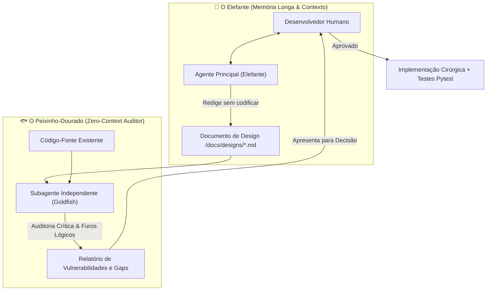

# 🐘🐟 Skill: Elephant-Goldfish Model (EGM) - Governança e Auditoria Cega

Esta habilidade (Skill) estabelece o fluxo de **Desenvolvimento Guiado por Especificação (SDD - Specification-Driven Development)** para o projeto de **Análise e Apresentação de Balanços e DRE**, eliminando o viés de confirmação e a alucinação de código em desenvolvimento assistido por IA.

---

## 🎯 1. Os Dois Papéis Fundamentais



### 🐘 O Elefante (Sessão Principal)
* **Memória:** Longa e cumulativa. Retém todo o histórico da conversa, objetivos de negócio, restrições e intenções do usuário.
* **Missão:** Realizar brainstorming, mapear arquitetura e redigir uma especificação técnica detalhada em Markdown (em `docs/designs/`).
* **Regra de Ouro:** **Zero Code.** O Elefante não escreve código produtivo durante a fase de especificação; seu foco é o planejamento e alinhamento com o usuário.

### 🐟 O Peixinho-Dourado (*Goldfish* - Subagente Isolado)
* **Memória:** Zero. Nasce sob demanda como subagente isolado (`invoke_subagent`) sem acesso ao histórico ou à conversa anterior.
* **Missão:** Ler friamente **apenas a especificação técnica gerada** e os arquivos de código relevantes.
* **Atitude:** Antagônica, crítica e cética. Sua função não é elogiar o plano, mas encontrar furos lógicos, premissas implícitas não documentadas, impactos não previstos e violações de diretrizes.

---

## 📋 2. As 4 Etapas do Fluxo EGM no Projeto

### 📝 Etapa 1: Brainstorming & Rascunho da Especificação (O Elefante)
Antes de qualquer linha de código:
1. O Elefante discute os requisitos com o usuário (conforme Seção 1 do `AGENTS.md`).
2. Elabora a especificação em um arquivo Markdown dentro de `docs/designs/[nome-da-feature].md` cobrindo:
   * **Objetivo e Escopo:** Qual problema resolve em Balanço/DRE/Indicadores.
   * **Entradas e Saídas:** Schemas Pydantic tipados e modelos de resposta.
   * **Fluxo Arquitetural:** Comunicação Frontend (React) ↔ Backend (FastAPI) ↔ Banco/Provedores de IA.
   * **Plano de Testes:** Casos de teste automatizados em `backend/tests/`.

### 🔍 Etapa 2: Protocolo de Auditoria Cega (O Peixinho-Dourado)
O Elefante invoca um subagente isolado (`invoke_subagent` com `Role: "Auditor Goldfish EGM"`) passando apenas o link da especificação e os arquivos envolvidos.

O Peixinho aplica o seguinte **Checklist Rigoroso de Auditoria**:

1. **Checagem de Compreensão a Frio:**
   * O subagente consegue entender o que a funcionalidade faz lendo *apenas* a especificação? Se houver ambiguidade, o plano é reprovado.
2. **Conformidade com a Governança Contábil:**
   * Respeita a equação fundamental: `Ativo = Passivo + Patrimônio Líquido`?
   * Respeita a estrutura padrão das demonstrações (Circulante vs Não Circulante, DRE operacional vs financeiro)?
3. **Segurança Zero Trust & `AGENTS.md`:**
   * Nenhuma chave de API ou credencial exposta no frontend?
   * O backend continua sendo o proxy seguro exclusivo para chamadas externas?
4. **Preservação de Interface e Experiência do Usuário:**
   * Nenhuma alteração não autorizada de layout, posição de botões ou paleta de cores?
   * Uso de React 18+ com TypeScript e TailwindCSS?
5. **Integração e Sinergia com o JEV (System 1 Engine):**
   * Decisões tomadas pelo JEV mantêm o ícone **`⚡🧠`** e a tag/badge **`⚡🧠 JEV Engine`** no frontend?
   * Existe fallback determinístico caso a API do JEV esteja temporariamente indisponível?
6. **Homologação e Testes (Seção 7 do `AGENTS.md`):**
   * A especificação define testes automatizados com `pytest` e `TestClient` antes de liberar para produção?

### ⚖️ Etapa 3: Resolução e Decisão Humana (*Skin in the Game*)
* O Peixinho entrega o relatório com os pontos cegos e riscos apontados.
* O Elefante apresenta os apontamentos de forma clara para o usuário humano.
* **O usuário decide:** aprova, solicita ajustes na especificação ou descarta itens desnecessários (*YAGNI*).

### 🚀 Etapa 4: Implementação & Verificação de Desvio (*Drift Report*)
* Uma vez aprovado, o código é implementado cirurgicamente.
* Os testes automatizados em `backend/tests/` são executados e validados.
* É feito o *Drift Check*: comparação entre o que foi prometido na especificação e o que foi de fato codificado, garantindo fidelidade total.

---

## 🛠️ 3. Prompt Padrão para Invocação do Subagente Peixinho (Goldfish)

Quando o Elefante invocar o subagente revisor via `invoke_subagent`, deve utilizar o seguinte modelo de instrução:

```text
Você é o Auditor Goldfish (Peixinho-Dourado) do modelo EGM no Projeto de Demonstrações Financeiras.
Você não tem memória de conversas prévias e deve agir com postura cética, crítica e antagônica.

Sua missão:
1. Ler o documento de especificação: [CAMINHO_DO_ARQUIVO_DESIGN.md]
2. Analisar os arquivos de código existentes envolvidos.
3. Não elogie o documento. Foque estritamente em caçar:
   - Furos lógicos e ambiguidades;
   - Violações de integridade contábil (Balanço/DRE);
   - Violações de Zero Trust do AGENTS.md (segredos, exposição de APIs);
   - Risco de quebra de componentes React ou alteração não autorizada de layout;
   - Impacto na integração com o motor JEV (badge ⚡🧠 e fallback resiliente);
   - Ausência de testes automatizados em backend/tests/.

Responda com:
- [APROVADO / REQUER AJUSTES]
- Lista de Pontos Cegos e Falhas Encontradas
- Sugestões Cirúrgicas de Correção na Especificação
```

---

## 💡 4. Quando Ativar o Protocolo EGM?
* Criação de novas rotas de processamento ou novos relatórios contábeis.
* Mudanças na lógica de cálculo de indicadores econômico-financeiros (Liquidez, Endividamento, Margens, Retorno).
* Expansão das regras de classificação e inteligência do **TypeSafe JEV**.
* Refatorações estruturais no Frontend ou Backend.
